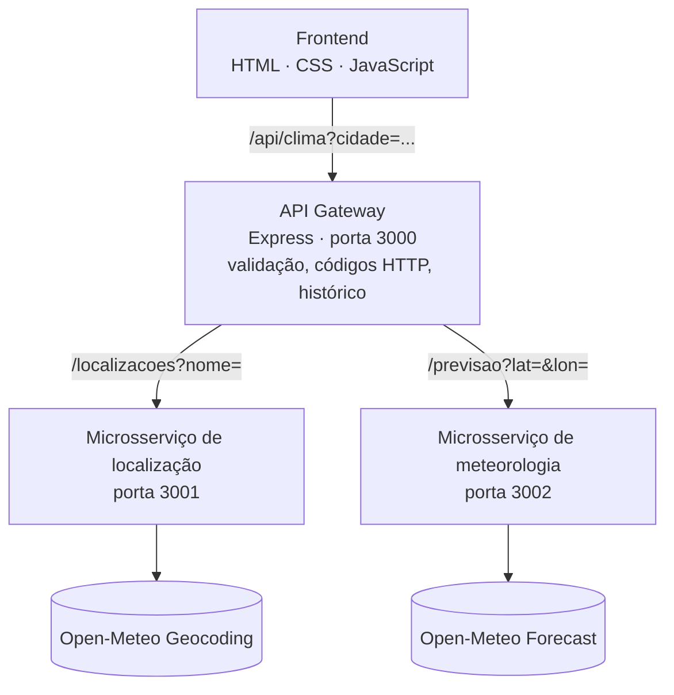

# API Meteo — Painel de Monitoramento Meteorológico

Aplicação que mostra as condições atuais e a previsão de 5 dias para qualquer cidade do mundo, usando a API pública do [Open-Meteo](https://open-meteo.com/).
O projeto segue a arquitetura proposta na atividade: **Frontend → API Gateway (Express) → microsserviços de localização e meteorologia**.



## Estrutura

```
api-meteo/
├── gateway/              # API Gateway (valida, orquestra, padroniza HTTP, histórico)
│   ├── app.js
│   └── index.js
├── servicos/
│   ├── localizacao/      # nome da cidade → latitude/longitude (Geocoding)
│   └── meteorologia/     # latitude/longitude → clima atual + 5 dias (Forecast)
├── public/               # frontend servido pelo gateway
│   ├── index.html
│   ├── style.css
│   ├── app.js
│   └── wmo.js            # tabela de códigos WMO → descrição + ícone
├── tests/                # testes automatizados (node:test)
├── docs/discussao.md     # respostas das questões para discussão em sala
└── scripts/iniciar-todos.js
```

## Como executar

Requisitos: **Node.js 18 ou superior**.

```bash
npm install
npm start          # sobe localização (3001), meteorologia (3002) e gateway (3000)
```

Abra **http://localhost:3000**.

Também é possível subir cada serviço em um terminal separado:

```bash
npm run start:localizacao
npm run start:meteorologia
npm run start:gateway
```

### Variáveis de ambiente

| Variável | Onde | Padrão | Descrição |
|---|---|---|---|
| `PORT` | gateway | `3000` | Porta do gateway (e do frontend) |
| `LOCALIZACAO_URL` | gateway | `http://localhost:3001` | URL do microsserviço de localização |
| `METEOROLOGIA_URL` | gateway | `http://localhost:3002` | URL do microsserviço de meteorologia |
| `PORT_LOCALIZACAO` / `PORT` | localização | `3001` | Porta do serviço |
| `PORT_METEOROLOGIA` / `PORT` | meteorologia | `3002` | Porta do serviço |
| `TIMEOUT_MS` | todos | `8000` | Tempo limite das chamadas externas |

## Documentação dos endpoints

### API Gateway (porta 3000)

#### `GET /api/clima?cidade={nome}[&id={idLocalidade}]`
Consulta completa: localização, condições atuais e previsão de 5 dias. O parâmetro opcional `id` escolhe uma localidade específica entre as cidades homônimas (sem ele, usa o primeiro resultado).

Exemplo: `GET /api/clima?cidade=Salvador`

```json
{
  "local": { "id": 3450554, "nome": "Salvador", "estado": "Bahia", "pais": "Brasil",
             "codigoPais": "BR", "latitude": -12.97, "longitude": -38.51, "fusoHorario": "America/Bahia" },
  "fusoHorario": "America/Bahia",
  "atual": { "horario": "2026-11-09T23:00", "temperatura": 26.1, "sensacaoTermica": 28.4,
             "umidade": 80, "codigoWmo": 2, "ventoVelocidade": 12.3, "ventoDirecao": 95,
             "indiceUv": 0, "dia": false },
  "unidades": { "temperatura": "°C", "vento": "km/h" },
  "previsao": [ { "data": "2026-11-10", "codigoWmo": 3, "maxima": 30.1, "minima": 24.2, "uvMaximo": 9.1 } ]
}
```

| Status | Quando |
|---|---|
| `200` | Consulta bem-sucedida |
| `400` | `cidade` vazia, com menos de 2 ou mais de 100 caracteres |
| `404` | Nenhuma localidade encontrada |
| `502` | Open-Meteo / microsserviço indisponível ou tempo esgotado |

Erros sempre seguem o formato `{ "status": 404, "erro": "mensagem" }`.

#### `GET /api/localidades?cidade={nome}`
Lista até 10 localidades com o mesmo nome (ex.: Salvador/BA e San Salvador). Mesmos códigos `200/400/404/502`.

#### `GET /api/historico`
Últimas 5 cidades consultadas (sem repetição, mais recente primeiro).
```json
{ "historico": [ { "id": 3450554, "nome": "Salvador", "estado": "Bahia", "pais": "Brasil", "consultadoEm": "2026-11-10T02:00:00.000Z", "...": "..." } ] }
```

#### `GET /api/saude`
Verificação simples: `{ "servico": "gateway", "status": "ok" }`.

### Microsserviço de localização (porta 3001)

`GET /localizacoes?nome={cidade}` → `{ "total": n, "resultados": [ ... ] }` — `400` entrada inválida, `404` sem resultados, `502` Geocoding fora do ar.
`GET /saude`

### Microsserviço de meteorologia (porta 3002)

`GET /previsao?lat={latitude}&lon={longitude}` → `{ fusoHorario, atual, unidades, previsao }` — `400` coordenadas inválidas, `502` Forecast fora do ar.
`GET /saude`

## Funcionalidades (checklist da atividade)

| # | Item | Onde |
|---|---|---|
| 1–3 | Consultar Salvador, cidades brasileiras e estrangeiras | Busca do frontend |
| 4–5 | Estado, país, latitude e longitude | Cabeçalho do resultado |
| 6 | Data e horário da observação | "Observação: dd/mm/aaaa às hh:mm" |
| 7 | Sensação térmica | Cartão de métricas |
| 8 | Velocidade e direção do vento | Cartão de métricas (km/h + ponto cardeal + seta) |
| 9 | Índice UV | Cartão de métricas (com classificação baixo → extremo) |
| 10 | Máximas e mínimas de 5 dias | "Próximos cinco dias" |
| 11 | Ícones por código WMO | `public/wmo.js` |
| 12 | Cidades inexistentes e campos vazios | Validação no frontend + 400/404 no gateway |
| 13 | Cidades homônimas | `GET /api/localidades` + seletor "Escolha a localidade correta" |
| 14 | Gráfico de temperaturas | Gráfico SVG de máximas e mínimas |
| 15 | Comparar duas cidades | Seção "Compare duas cidades" |
| 16 | Botão de atualizar | "↻ Atualizar" |
| 17 | Histórico das últimas 5 cidades | `GET /api/historico` + "Consultas recentes" |
| 18 | Busca e meteorologia em dois microsserviços | `servicos/localizacao` e `servicos/meteorologia` |
| 19 | API Gateway | `gateway/` |
| 20 | Documentação da arquitetura e testes | Este README |

## Testes

```bash
npm test
```

Os testes usam o `node:test` (nativo do Node) e simulam o Open-Meteo, então rodam sem internet. Cobrem os cenários obrigatórios:

| Cenário | HTTP esperado no gateway | Teste |
|---|---|---|
| `cidade=Salvador` | 200 · consulta válida | ✅ |
| `cidade=Recife` | 200 · consulta válida | ✅ |
| `cidade=São Paulo` | 200 · consulta válida | ✅ |
| cidade vazia | 400 · campo inválido | ✅ |
| cidade inexistente | 404 · local não encontrado | ✅ |
| API externa indisponível ou timeout | 502 · falha de serviço externo | ✅ |

Para testar manualmente com o servidor rodando:

```bash
curl -i "http://localhost:3000/api/clima?cidade=Salvador"        # 200
curl -i "http://localhost:3000/api/clima?cidade=Recife"          # 200
curl -i "http://localhost:3000/api/clima?cidade=S%C3%A3o%20Paulo" # 200
curl -i "http://localhost:3000/api/clima?cidade="                # 400
curl -i "http://localhost:3000/api/clima?cidade=Xyzabcqwe"       # 404
# 502: pare o microsserviço de meteorologia (Ctrl+C no terminal dele) e consulte de novo
```

## Hospedagem separada (ex.: Render)

Crie **três Web Services** apontando para o mesmo repositório, todos com *Build command* `npm install`:

| Serviço | Start command | Variáveis |
|---|---|---|
| meteo-localizacao | `node servicos/localizacao/index.js` | — |
| meteo-meteorologia | `node servicos/meteorologia/index.js` | — |
| meteo-gateway | `node gateway/index.js` | `LOCALIZACAO_URL=https://meteo-localizacao.onrender.com`, `METEOROLOGIA_URL=https://meteo-meteorologia.onrender.com` |

O Render define `PORT` automaticamente para cada serviço. O frontend é servido pelo próprio gateway, então a URL do gateway é a URL da aplicação.

## Capturas de tela

Coloque as capturas na pasta `docs/capturas/` e referencie aqui, por exemplo:

```markdown


```
